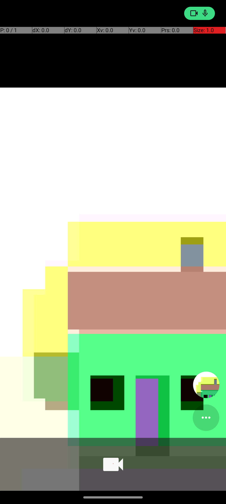

# CameraTakeVideo · published evidence

[简体中文](README.zh-CN.md) · [Audit](../../REPRODUCTION-2026-10-13.md)

Original **125.921 s** → formal replay **12.352 s**, raw ratio **10.19×**.
Official reward **1/1**, nine matched segments, retries/fallback/timeouts **0**.
Original includes recorder overhead; replay includes native connection,
checkpoints, final evidence and close. Setup/official evaluation are outside.

## Included

- `original/`: nine recorded actions (started/completed), all 27 checkpoint events,
  and all 37 distinct screenshot/native-tree artifacts referenced by them.
  Sequences, timestamps, action arguments and correlation IDs are preserved.
- `original/source-manifest.json`: exact original manifest. The exported
  `manifest.json` declares the 47-event publication projection (including two
  data-free attempt boundaries), not the full
  210-event raw log. No original in local storage was changed.
- `synthesized-v1/`: byte-identical measured module, semantic plan/ledger,
  oracle, assertion/calibration decisions, gates and qualification history.
- `formal-replay/`: exact final evaluation, full runtime checkpoint evidence,
  results, final screenshot/native tree and fresh-context provenance.
- `task-state/`: task metadata and frozen permission/start-environment contracts.
- `publication.json`: explicit exclusions, original identities and hashes for
  every byte-identical exported file. `SHA256SUMS` covers the published bundle.

Model requests, progress/execution dumps, reasoning, HTML reports and command
logs are intentionally excluded. Opaque pickle/snapshot state and complete failed
development folders are not published; their history remains in qualification.
This is auditable recorded device evidence, not an unredacted model transcript
or a self-contained emulator restore image. All screenshots use the synthetic
emulator camera, not a host webcam.

## Inspect or regenerate

From this directory:

```bash
shasum -a 256 -c SHA256SUMS
```

The measured plan retains original host paths to preserve its published hash.
`portable-replay.ts` is an explicitly separate relocation-only entry that resolves
those three image references to this checkout without modifying recorded actions
or checkpoints. It has not received an additional formal device measurement.
To generate new evidence, use the pinned AndroidWorld setup, a **new** output
directory and the public CLI (from repository root):

```bash
npm run android-world:setup -- --task CameraTakeVideo --seed 70001 --output <new-output>
npm run benchmark:android:android-world -- --mode replay --task CameraTakeVideo \
  --seed 70001 --output <new-output> \
  --replay-module benchmark/android/android-world/evidence/camera-take-video-20261013/portable-replay.ts
```

Fresh environment setup is required. Do not overwrite the published result or
reuse these historical durations for a new run.


